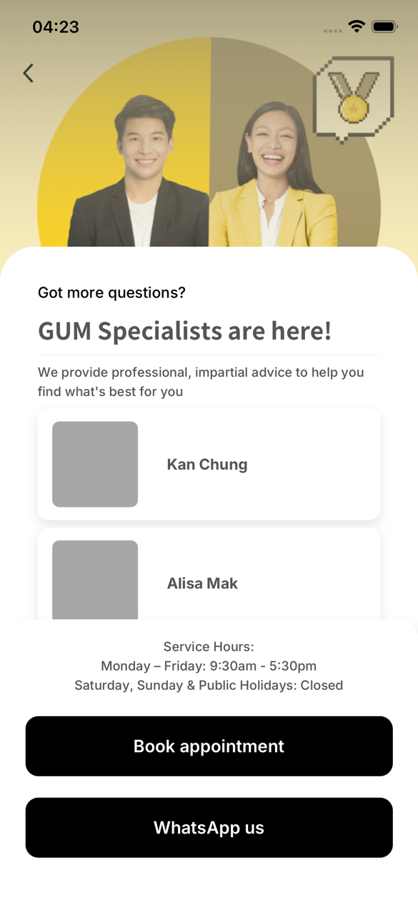
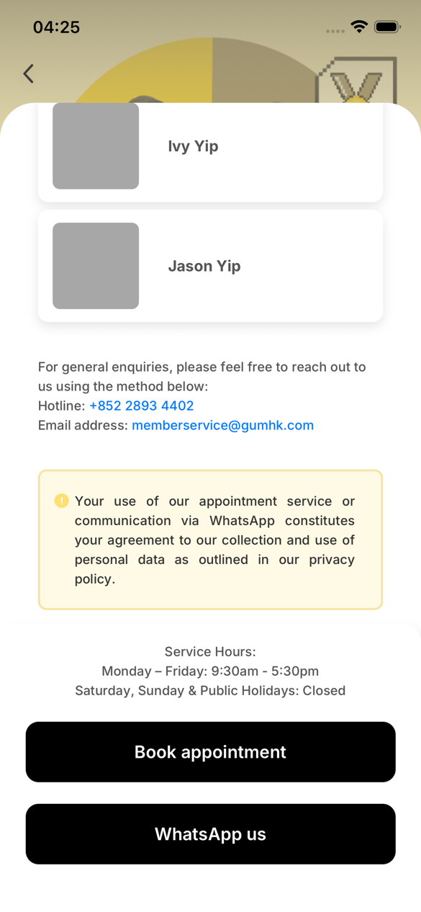
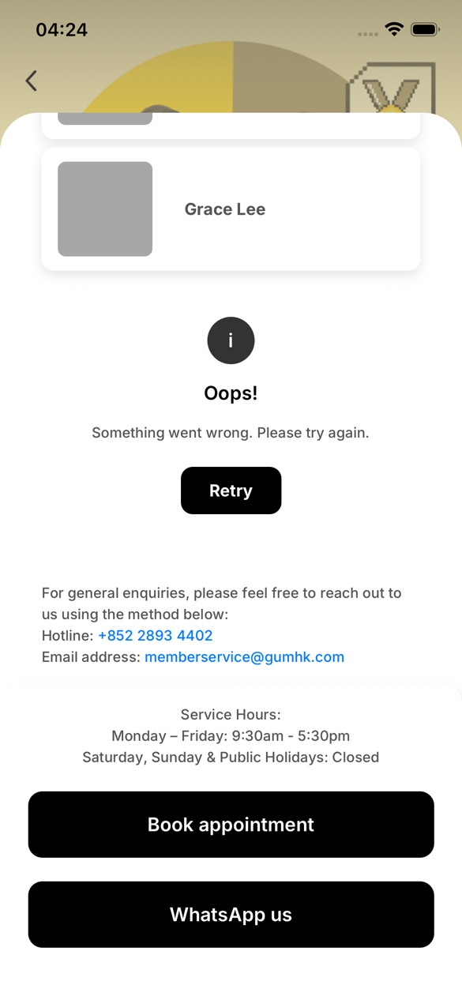
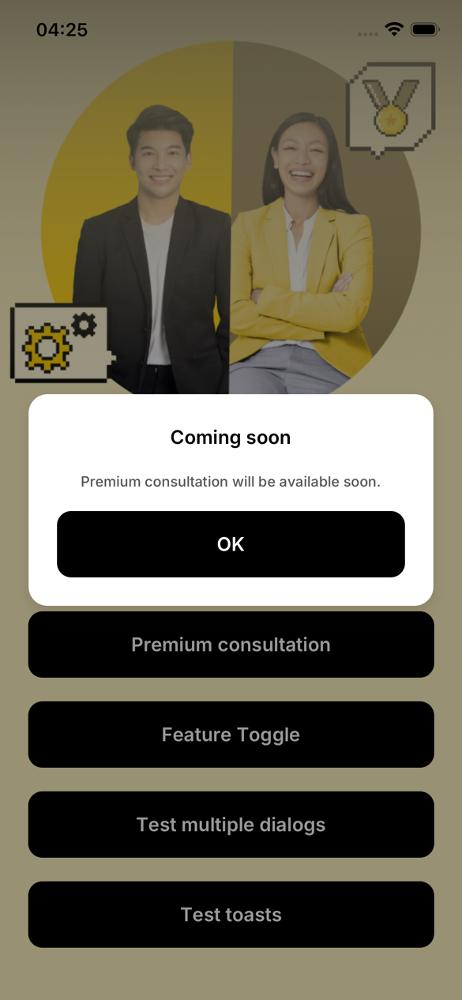

# Premium Consultation

The Premium Consultation screen of the GUM app, built with React Native (Expo SDK 58, TypeScript). It introduces the ES team's Specialists and lets the user book an appointment, chat on WhatsApp, call the hotline or send an email. Copy is in English and Traditional Chinese (Hong Kong), following the device language.

The full specification is [`docs/SPEC.md`](docs/SPEC.md); decisions are recorded as ADRs in [`docs/adr/`](docs/adr/), and domain terms in [`GLOSSARY.md`](GLOSSARY.md).

## Demo

<table>
  <tr>
    <th>Consultation</th>
    <th>Contact info</th>
    <th>Error and Retry</th>
    <th>Feature off</th>
  </tr>
  <tr>
    <td align="center"></td>
    <td align="center"></td>
    <td align="center"></td>
    <td align="center"></td>
  </tr>
</table>

The demo videos, recorded on an iPhone (also in [`demo/`](demo/)):

<table>
  <tr>
    <th><code>v1.1.2</code>, 3 min 52 s</th>
    <th width="24"></th>
    <th><code>v1.0.0</code>, 1 min 4 s</th>
  </tr>
  <tr>
    <td><video src="https://github.com/user-attachments/assets/36d7889e-905e-4035-9241-3f0147160600" controls></video></td>
    <td width="24"></td>
    <td><video src="https://github.com/user-attachments/assets/b7251e2b-9eae-4d74-a805-68791c25cc78" controls></video></td>
  </tr>
</table>

What the `v1.1.2` video shows:

| From | What it shows |
|---|---|
| 0:00 | Infinite scroll: 10 Specialists per page, a spinner below the last card while the next page loads |
| 0:30 | The hotline and email links |
| 0:44 | Book appointment (in-app browser) and WhatsApp us (pre-filled message) |
| 1:08 | Home, then the Dialog demo: one dialog, two buttons asking for the same dialog, three dialogs in turn |
| 1:28 | The Toast demo with the press throttle on: presses within 500 ms show nothing |
| 1:48 | Premium consultation switched off: the "Coming soon" dialog |
| 2:00 | Dialog de-duplication and the queue switched off: the same dialog stacks |
| 2:28 | The press throttle switched off: every press shows a toast |
| 2:56 | Simulated loading failure: the error view on a failed page, and Retry |

What the `v1.0.0` video shows:

| From | What it shows |
|---|---|
| 0:00 | The app opens on the Consultation screen: the 3 Specialists, then the contact info and agreements |
| 0:15 | The hotline and email links |
| 0:30 | Book appointment (in-app browser) |
| 0:39 | WhatsApp us (pre-filled message) |

## Quick start

> [!WARNING]
> **Known warnings from third-party packages.** `npm ci` reports **29 high-severity vulnerabilities**, and on launch Metro logs **`[Reanimated] Dependencies should only be used on the web and are always ignored on native.`** Both come from third-party packages with no fix released yet; neither package ships in the app or changes how it behaves. See [Known limitations](#known-limitations) for the details. Don't run `npm audit fix --force`: it would downgrade Expo to SDK 44 and break the project.

You need:

- **Node 24**: the exact version is in [`.nvmrc`](.nvmrc). With [nvm](https://github.com/nvm-sh/nvm), step 1 installs it.
- **Xcode** (macOS) for the iOS simulator, or **Android Studio** for an Android emulator.

1. Get the code and install the dependencies:

   ```sh
   git clone https://github.com/LoS-Light/PremiumConsultation.git
   cd PremiumConsultation
   nvm install   # installs and switches to the Node version in .nvmrc
   npm ci
   ```

2. Start the app:

   ```sh
   npx expo start
   ```

3. In the same terminal, press **`i`** for the iOS simulator or **`a`** for the Android emulator. Expo CLI installs the matching Expo Go and opens the app on Home.

Then see [Trying `v1.1.2`](#trying-v112) for what each button does.

### `v1.1.2` or `v1.0.0`

`main` is `v1.1.2`, the latest. The assignment's general and senior requirements disagree on the entry point, so they ship as two releases (see [Releases](#releases)):

| | `v1.1.2` (`main`): senior requirements | `v1.0.0`: general requirements |
|---|---|---|
| Opens on | Home, with four buttons | The Consultation screen, as in Figma |
| Specialists | 103, loaded 10 at a time as you scroll | The 3 from the PRD, loaded in one request |
| Feature flag | The screen can be switched off; a "Coming soon" dialog shows instead | None |
| Error handling | Error view and Retry; failures can be simulated | None: the hardcoded data can't fail |
| Back button | Returns to Home | Shown but does nothing, as in the PRD |
| Demo tools | Feature toggles sheet, Dialog and Toast demo screens | None |

To run `v1.0.0`, check out its tag and install again, since its dependencies differ:

```sh
git checkout v1.0.0
npm ci
npx expo start
```

To return to the latest: `git checkout main && npm ci`.

### On a phone

The project uses Expo SDK 58, and each Expo Go release supports one SDK only.

| Device | How |
|---|---|
| Android | Connect it with USB debugging on and press `a`, or scan the QR code with Expo Go. Expo CLI installs the matching Expo Go on connected devices. |
| iPhone | When writing this, the App Store's Expo Go only supports SDK 57, so it reports "Project is incompatible with this version of Expo Go". Either wait until Expo Go for SDK 58 reaches the App Store and scan the QR code, or build the app onto the phone with Xcode: turn on Developer Mode on the iPhone, connect it, and run `npx expo run:ios --device` (needs an Apple ID signed in to Xcode). |

To see the Chinese copy, set the device language to Chinese (any `zh` locale shows Traditional Chinese, Hong Kong); every other language shows English.

## Trying `v1.1.2`

Home has four buttons:

| Button | What it does |
|---|---|
| **Premium consultation** | Opens the Consultation screen, or the "Coming soon" dialog when the feature is switched off |
| **Feature Toggle** | Opens the Feature toggles sheet (below) |
| **Test multiple dialogs** | The Dialog demo screen, for the brief's bonus question |
| **Test toasts** | The Toast demo screen, for the press throttle |

### Feature toggles

Every switch lives in memory only: restarting the app resets it.

| Switch | Default | Off / on shows |
|---|---|---|
| Enable Premium consultation | on | Off: the entry button shows the "Coming soon" dialog, and the Consultation screen itself sends you back if reached another way (a deep link) |
| Enable dialog de-duplication | on | Off: a dialog asked for while it is already showing or waiting shows again |
| Enable dialog queue | on | Off: dialogs stop waiting their turn and stack on top of each other |
| Enable press throttle | on | Off: buttons react to every press |
| Simulate loading failure | off | On: each Specialist request fails 30% of the time, to show the error view and Retry |

**The in-app flag switch is a demo shortcut, not the production approach.** In production, whether the screen is enabled would come from a source the business controls without an app release: the Q2 CMS, Firebase Remote Config or similar. The app reads flags only through the `FeatureFlagService` interface, so a remote implementation replaces the in-memory one in one statement ([`src/app/featureFlagService.ts`](src/app/featureFlagService.ts)), with a safe default (off) when the remote value is unavailable. No screen or hook changes.

### Demo walkthroughs

- **Feature flag:** switch *Enable Premium consultation* off, press *Premium consultation*: the "Coming soon" dialog shows. Switch it back on: the screen opens.
- **Double press (the brief's "not over-shown"):** with the flag off, press the entry button twice quickly: one dialog. Switch *Enable press throttle* off and do it again: still one dialog, because the dialog manager stops it.
- **Bonus question, several buttons and dialogs:** on *Test multiple dialogs*, *Press two buttons, same dialog* sends the same dialog from two entry points at once: it shows once. *Three dialogs at once*: A, then B, then C as each closes. Switch *dialog de-duplication* and *dialog queue* off and press *Press two buttons, same dialog* again: two copies stack, the brief's over-shown dialog.
- **Press throttle:** on *Test toasts*, every press that gets through shows a toast. Tap *Toast A* quickly: with the throttle on, presses within 500 ms show nothing; with it off, every press shows a toast.
- **Infinite scroll:** open the Consultation screen and scroll: 10 Specialists per page, a spinner below the last card while the next page loads, the contact info once all 103 are loaded.
- **Error and Retry:** switch *Simulate loading failure* on, open the Consultation screen (again, if the first page loaded): a failed first page shows the error view in the list; a failed next page shows it below the loaded Specialists. Retry loads the page again.
- **Both languages:** set the device language to Chinese and back.

## Senior requirements

### Feature flag ([SPEC §7](docs/SPEC.md))

- `FeatureFlagService` (`isEnabled`, `subscribe`) behind a context, read with `useFeatureFlag(flag)`. Today it is `LocalFeatureFlagService`, in memory; see above for production.
- **Guarded in two places:** the entry button (`useConsultationEntry`: navigate, or the "Coming soon" dialog), and the Consultation route itself (`useConsultationGate`), so reaching the screen another way (a deep link, a flag turned off while it is open) can't bypass the flag: it shows the dialog and goes back, loading nothing.

### Dialog over-shown, and several buttons and dialogs ([SPEC §8](docs/SPEC.md))

- A central **DialogManager** (`DialogProvider` + `useDialog`) shows dialogs by ID. Its guard is a queue kept in a plain array, read and written synchronously, so two presses in the same tick both see the first one (React state would read the same stale value twice).
- **Same ID** showing or already queued → ignored, whichever button asked. Once closed, the same ID can show again.
- **Different IDs** → queued: one dialog at a time, the next when the current one closes. Dropping or replacing the current one would lose or cut short a message; a time-based throttle would let a duplicate through once the window passes, and block a real request right after a dialog closes.
- A dialog is closed by its own request key, so a double close (the Android back button and the dialog's button together) can't drop the next one.
- The guard is proven by tests that press twice past the button throttle, so only the DialogManager can stop the second dialog.

### Duplicate-press protection, three layers ([SPEC §8a](docs/SPEC.md))

| Layer | Guards against | How |
|---|---|---|
| 1. Press throttle | Hand jitter, rapid taps | `ThrottledPressable`: the first press runs, presses within 500 ms are ignored. Every pressable uses it |
| 2. `navigate()` | Stacking the same screen | React Navigation's `navigate()` goes to a screen already in the stack instead of pushing it again, so no app-level guard is needed (unlike Flutter's `Navigator.push`, which always pushes). Screens are never opened with `push` |
| 3. DialogManager | The same dialog twice | By ID, as above |

Layer 1 only smooths out jitter; layers 2 and 3 are the guarantees. The back button also ignores a press once its screen is leaving, since `goBack()` has no such de-duplication.

### Plain vs infinite list ([SPEC §6.3](docs/SPEC.md))

`v1.0.0` loads every Specialist in one request (`useQuery`); `v1.1.2` loads them 10 at a time (`useInfiniteQuery`, offset pagination, [ADR-007](docs/adr/0007-offset-pagination.md)).

| | Plain (`v1.0.0`) | Infinite (`v1.1.2`) |
|---|---|---|
| Fetching | One request, all items | One request per page, when a fifth of a screen of list is left |
| Time to first content | Grows with the list | Constant: the first page only |
| Memory, data | O(n) | O(pages loaded × page size) |
| Memory, rendered views | Bounded by FlatList virtualization | Same |
| Scrolling | Scrollbar length known up front | Grows as pages load; a spinner below the last card |
| Failure | One request fails → the whole list fails | First-page and next-page failures are handled separately |
| Extra concerns | — | Duplicate `onEndReached` calls, retrying one page, overlapping pages (items de-duplicated by ID) |

Virtualization limits rendered views; pagination limits fetched data and network cost. They solve different problems.

## Tech stack

| Area | Choice | Used for |
|---|---|---|
| Framework | [Expo](https://docs.expo.dev/versions/v58.0.0/) SDK 58 (managed workflow), React Native 0.88, React 19.3 | The app on iOS and Android from one codebase; no native folders are committed |
| Language | TypeScript 6.0, `strict` | Every source and test file |
| Server state | [TanStack Query](https://tanstack.com/query/v5) v5 | Loading, caching and errors for the Specialist list: `useQuery` in `v1.0.0`, `useInfiniteQuery` (10 per page) in `v1.1.2` |
| Navigation | [React Navigation](https://reactnavigation.org/) 7, JS stack (`@react-navigation/stack`) | Home → Consultation and the demo screens, with iOS's push, pop and swipe back on both platforms ([ADR-013](docs/adr/0013-js-stack-with-ios-transitions.md)). Not Expo Router: two screens don't need file-based routes |
| Bottom sheets | [`@gorhom/bottom-sheet`](https://gorhom.dev/react-native-bottom-sheet/) 5, on Reanimated 4 and Gesture Handler 3 | The Consultation content sheet over the hero ([ADR-012](docs/adr/0012-content-bottom-sheet.md)) and the Feature toggles sheet |
| Localization | i18next, react-i18next, `expo-localization` | English and Chinese (Hong Kong) copy, following the device language |
| Expo modules | `expo-image`, `expo-linear-gradient`, `expo-web-browser`, `expo-font` with Inter and Noto Sans TC (`@expo-google-fonts`), `expo-splash-screen`, `expo-status-bar` | Images and SVG icons, the hero's fade, the booking page in an in-app browser, the Figma fonts, holding the splash screen until the fonts load |
| Tests | Jest 30 (`jest-expo`), React Native Testing Library 14 | 94 tests, written test-first at agreed seams ([ADR-010](docs/adr/0010-test-driven-development.md)) |
| Code quality | ESLint 9 (`eslint-config-expo`), Prettier 3, GitHub Actions | Lint and formatting; CI runs the type check, lint and tests on every pull request |
| Tooling | Node 24.22.1 ([`.nvmrc`](.nvmrc)), npm | `npm ci` installs the exact versions in `package-lock.json` |

No global state library: server data lives in TanStack Query, the feature flags in a small service read with `useSyncExternalStore`, and the dialog queue in a plain array inside the DialogManager. Every UI part (buttons, switch, spinner, dialogs, toasts) is a custom component, so iOS and Android look the same.

## Architecture

Three layers: **View** (components, no logic) → **ViewModel** (hooks) → **Data** (a repository interface). Views and hooks never import a concrete repository.

```
.
├── index.ts                      Entry point: registers App
├── app.json                      Expo config: name, version, icons, splash, plugins
├── assets/                       App icons, splash, the hero image, SVG icons (back, info)
├── demo/                         The README's screenshots and demo videos
├── docs/
│   ├── SPEC.md                   The full specification
│   └── adr/                      Architecture decision records
├── GLOSSARY.md                   Domain terms (Specialist, Premium consultation, …)
├── jest.setup.ts                 Jest mocks for native modules and the bottom sheet
├── .github/workflows/ci.yml      CI: type check, lint, tests
└── src/
    ├── app/                      Composition root: the only place concrete services are picked
    │   ├── App.tsx               Fonts, splash screen, the QueryClient
    │   ├── AppProviders.tsx      Every provider in one place, shared by App and the tests
    │   ├── navigation.tsx        The stack: Home → Consultation, Dialog demo, Toast demo
    │   ├── specialistRepository.ts   Picks the repository: hardcoded today, the CMS later
    │   └── featureFlagService.ts     Picks the flag service: in memory today, remote later
    │
    ├── data/specialist/          Data layer
    │   ├── Specialist.ts         The model, and Page / PageParams for offset pagination
    │   ├── SpecialistRepository.ts           The interface screens depend on
    │   ├── HardcodedSpecialistRepository.ts  Pages a local list, simulated latency and failure
    │   ├── CmsSpecialistRepository.ts        Stub for the Q2 CMS
    │   ├── RepositoryProvider.tsx            Provides the repository (useSpecialistRepository)
    │   └── specialists.fixture.ts            The 3 Figma Specialists and 100 generated ones
    │
    ├── features/                 One folder per screen, each split into view/ and viewmodel/
    │   ├── home/
    │   │   ├── view/HomeScreen.tsx                The four buttons over the hero
    │   │   ├── view/FeatureTogglesSheet.tsx       The five demo switches
    │   │   ├── viewmodel/useConsultationEntry.ts  Opens the screen, or the Coming soon dialog
    │   │   └── viewmodel/useFeatureToggle.ts      One switch of the sheet
    │   ├── consultation/
    │   │   ├── view/ConsultationScreen.tsx        Hero, content sheet with the list, bottom section
    │   │   ├── view/ConsultationHeader.tsx        "Got more questions?" and the intro
    │   │   ├── view/SpecialistCard.tsx            Photo (or placeholder) and name
    │   │   ├── view/ContactInfo.tsx               Hotline and email, tappable
    │   │   ├── view/AgreementsNotice.tsx          The WhatsApp and privacy notice
    │   │   ├── view/ConsultationBottomSection.tsx Service hours, Book appointment, WhatsApp us
    │   │   ├── view/states/                       SpecialistSkeleton, EmptyState, InlineErrorView
    │   │   ├── view/layout.ts                     Figma measurements: padding, sheet position
    │   │   ├── view/useNextPageSpinner.ts         Keeps the spinner's space until the list grows
    │   │   ├── view/useContentSheetAnimationConfigs.ts  No sheet animation during the push
    │   │   ├── viewmodel/useInfiniteSpecialistsQuery.ts  Pages of 10 through useInfiniteQuery
    │   │   ├── viewmodel/useConsultationActions.ts  Booking, WhatsApp, phone and email
    │   │   ├── viewmodel/useConsultationGate.ts     The route's own feature-flag guard
    │   │   └── viewmodel/useComingSoonDialog.ts     The Coming soon dialog, by ID
    │   ├── dialogDemo/
    │   │   ├── view/DialogDemoScreen.tsx
    │   │   └── viewmodel/useDemoDialogs.ts        One dialog, the same one twice, three at once
    │   └── toastDemo/
    │       ├── view/ToastDemoScreen.tsx
    │       ├── view/ToastMessage.tsx              Fades in, stays 2 s, fades out
    │       └── viewmodel/useToastStack.ts         No queue, so only the press throttle stops repeats
    │
    ├── shared/                   Used by more than one feature
    │   ├── theme.ts              Colours, gradients, text styles and shadows from the Figma variables
    │   ├── config/               contact.ts (booking URL, WhatsApp, hotline, email),
    │   │                         featureFlags.ts (defaults), specialists.ts (latency, page size,
    │   │                         failure rate), ui.ts (the 500 ms press throttle)
    │   ├── dialog/               The DialogManager: dialogQueue.ts (the rules), DialogProvider.tsx
    │   │                         (useDialog), DialogView.tsx (the card)
    │   ├── featureFlags/         FeatureFlagService (the interface), LocalFeatureFlagService,
    │   │                         FeatureFlagProvider (useFeatureFlag)
    │   ├── i18n/                 createI18n, resolveLanguage (any zh → zh-HK), useAppLanguage,
    │   │                         locales/en.json and locales/zh-HK.json
    │   └── ui/                   ThrottledPressable and useThrottledPress, PrimaryButton,
    │                             ToggleSwitch, LoadingSpinner, HeroBanner, BackNavBar,
    │                             HeroActionsScreen (the layout of Home and the demo screens),
    │                             useSheetAnimationConfigs, bottomControlsPadding
    │
    ├── types/assets.d.ts         Types for imported images: a .png or .svg is a Metro asset ID
    └── test/                     renderApp (the app opened on any screen), controllableClock,
                                  fake and steerable repositories
```

Tests sit beside the code they cover (`*.test.ts` / `*.test.tsx`).

- **Data** ([ADR-002](docs/adr/0002-specialist-repository.md)): screens read Specialists only through `SpecialistRepository`, provided by `RepositoryProvider`. The interface is paginated by offset, so infinite scroll needed no new interface. The hardcoded repository adds a simulated delay (800 ms in `v1.0.0`, 1500 ms in `v1.1.2`) so the loading states are visible, and can fail at random for the demo.
- **Layout** ([ADR-012](docs/adr/0012-content-bottom-sheet.md)): the hero image stays fixed and the content is a `@gorhom/bottom-sheet` over it. The sheet opens at Figma's card position, can grow up to the nav bar and never closes. Its list holds the header, Specialists, contact info and agreements notice; its footer is the persistent bottom section with the service hours and the two buttons.
- **Navigation** ([ADR-013](docs/adr/0013-js-stack-with-ios-transitions.md)): React Navigation's JS stack with iOS's push, pop and swipe back on both platforms.
- **Actions**: every side effect (`expo-web-browser`, `Linking`) goes through `useConsultationActions`, so tests can mock it.
- **Localization**: `i18next` with `expo-localization`. Copy comes from the PRD; the contact sentence uses `<Trans>` so each language keeps its own sentence structure with tappable links.
- **Android matches iOS:** the sheet's position, font weights, bottom insets, list overscroll, the bottom sheets' spring, the stack transitions, the switch and the loading spinner are all made to look and behave like iOS.

### Swapping to the CMS

The data source is chosen in one statement in [`src/app/specialistRepository.ts`](src/app/specialistRepository.ts). When the Q2 CMS exists, implement `CmsSpecialistRepository.getSpecialists` and replace that statement:

```ts
export const specialistRepository: SpecialistRepository = new CmsSpecialistRepository();
```

No screen, hook or test changes. With a real API, also restore TanStack Query's automatic retries: they are off (`retry: false` in `App`) so a simulated failure reaches the error view at once.

## Checks

```sh
npm run typecheck   # tsc --noEmit
npm run lint        # ESLint and Prettier
npm test            # Jest and React Native Testing Library
npx expo-doctor
```

CI runs `npm ci`, the type check, lint and tests on every pull request ([`.github/workflows/ci.yml`](.github/workflows/ci.yml)).

Behaviour is developed test-first at agreed seams ([ADR-010](docs/adr/0010-test-driven-development.md), SPEC §13). Pure styling, animations and gestures, which the mocked bottom sheet and the test renderer can't show, are checked on the iOS simulator and an Android emulator.

## Releases

The assignment's general and senior requirements disagree on the entry point (the Figma screen versus a flag-gated Home button), so the work ships in two releases ([ADR-011](docs/adr/0011-two-releases.md)). The latest is `v1.1.2`.

| Release | Entry point | Contents |
|---|---|---|
| `v1.0.0` (general requirements) | The Consultation screen | Hero and content bottom sheet matching Figma; the three base Specialists loaded in one request through TanStack Query from a swappable repository; loading skeleton and empty state; Book appointment (in-app browser), WhatsApp us (pre-filled message per language), tappable hotline and email; English and Chinese (Hong Kong) copy from the PRD; a back button that is shown but does nothing |
| `v1.1.2` (senior requirements, latest) | A Home screen | The Consultation screen behind a feature flag, with a de-duplicated "coming soon" dialog; infinite scroll over 103 Specialists; **error handling** (error view and Retry); a working back button; a Feature toggles sheet and two demo screens for duplicate-press protection; Android matching iOS (transitions, swipe back, fonts, spinner, switches) |

`v1.1.0` is the same app as `v1.1.2`, released before the demo, the quick start and the notes on the expected warnings were added to this README.

**Error handling ships in `v1.1.2`, not `v1.0.0`.** `v1.0.0` reads hardcoded data that cannot fail, so the error view, Retry and the switch that simulates failures arrive together in the senior release ([ADR-011](docs/adr/0011-two-releases.md)).

To run a release, check out its tag (`git checkout v1.0.0` or `v1.1.2`), then `npm ci` and `npx expo start` as in [Quick start](#quick-start).

## Known limitations

- **`npm audit` reports 29 high-severity vulnerabilities, all in development tools.** They trace back to two packages with no patched version released yet:
  - `braces` ([GHSA-vfj7-8cjw-p6xm](https://github.com/advisories/GHSA-vfj7-8cjw-p6xm)): deeply nested patterns can exhaust the stack. Metro and Jest use it to match file paths against the project's own patterns, never user input.
  - `node-forge` ([GHSA-86w9-cpqp-85rv](https://github.com/advisories/GHSA-86w9-cpqp-85rv)): RSA signature verification accepts extra nested fields. The Expo CLI uses it for code signing of EAS Update, which this app doesn't use.

  The other 27 are packages that depend on these two (`expo`, `react-native`, `metro`, `jest-expo`, …). Neither package is in the app: the exported iOS and Android bundles contain neither. `npm audit fix --force` would "fix" them by downgrading Expo to SDK 44 and React Native to 0.72, so don't run it; update when Expo ships patched versions.
- **A Reanimated warning in development.** On launch, Metro logs `[Reanimated] Dependencies should only be used on the web and are always ignored on native.` once. It comes from `@gorhom/bottom-sheet` 5.2.14, the latest, which passes dependency arrays to 28 Reanimated hooks; Reanimated 4.6 and later warns about that because native ignores them. The sheets behave the same, and release builds don't log it. It is reported upstream as [gorhom/react-native-bottom-sheet#2785](https://github.com/gorhom/react-native-bottom-sheet/issues/2785).
- Once the list inside the expanded sheet has been scrolled, collapsing the sheet needs a new drag that starts at the top of the list. This is how `@gorhom/bottom-sheet` hands gestures between the sheet and its list.
- The contact info and agreements notice are at the end of the list, so in `v1.1.2` they are reached only after all 103 Specialists have loaded (SPEC §6.5).
- The hotline is shown as "+852 2893 4402" in both languages, from one config value; the PRD's Chinese copy writes it as "28934402".
- If the system cannot open a link (for example, no mail app is set up), nothing is shown to the user.
- The in-app feature toggles are for the demo (see above).
